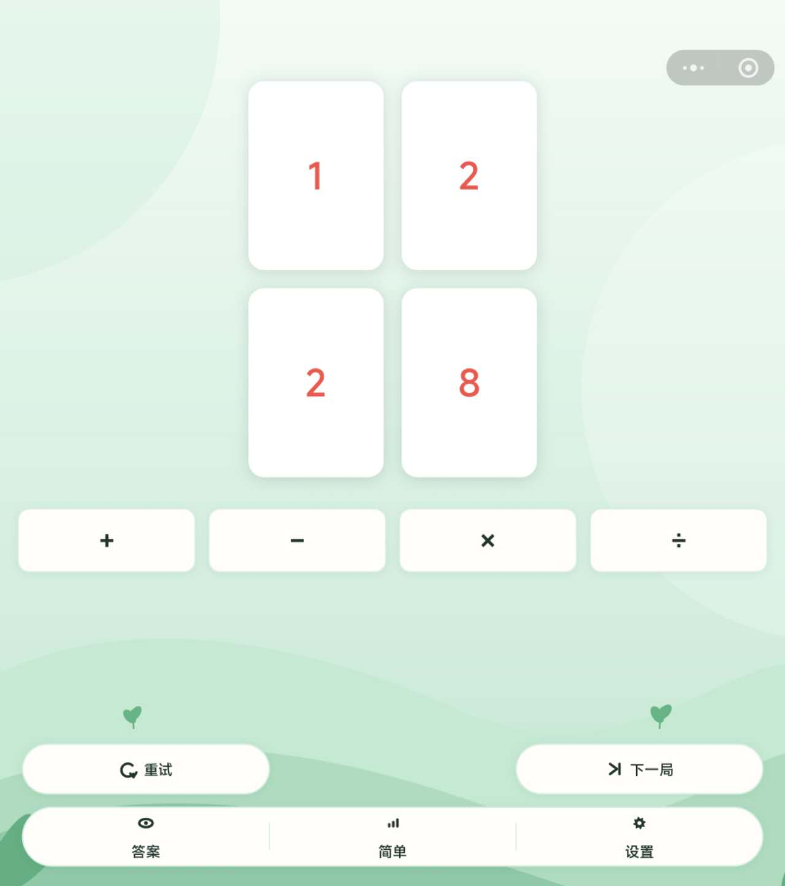

# 测试问题跟踪

未结束的问题用下面这一张表，一行一条。已结束的问题在「close的问题」，按编号从大到小排，编号保持不变，不重新编号。先讨论再改代码。

**状态：** `open`（预览红色）/ `in progress` / `close`（预览绿色）。只给状态列上色。颜色靠工作区 `markdown.styles` 加载 [md-preview.css](md-preview.css)；预览关掉后再开一次才会生效。

**解决方案：** 讨论要点 + 末尾结论（`修改代码` / `won't fix` / `not a bug`）。格子内换行用 ` `。

日期：`YYYY-MM-DD`。未结束的结束日期留空。结论是「修改代码」时，提交链接放在结束日期下面，例如 `2026-10-07 [9e9ebd9](https://github.com/ecaijw/CardGame/commit/9e9ebd9)`。没有代码提交的 close（只改文档、`won't fix`、`not a bug`）不写。

表头下一行必须是分隔行（每个格子只有 `---`），再往下才是问题。

| 编号  | 问题描述                                                                                      | 解决方案                                           | 状态   | 创建日期       | 结束日期 |
| --- | ----------------------------------------------------------------------------------------- | ---------------------------------------------- | ---- | ---------- | ---- |
| 10  | 连胜：重开本局、查看答案、没打完回首页，会不会把连胜清零？                                                             | 当前代码：弹出失败清零，弹出成功 +1。重开、看答案、回首页不改连胜。是否要断待确认。结论： | open | 2026-09-15 |      |
| 11  | 统计重置：只靠清缓存，还是设置页加「清零」？                                                                    | 当前无清零按钮，清缓存会一并清掉。是否要页上入口待确认。结论：                | open | 2026-09-15 |      |
| 12  | 数字 / 扑克显示。待确认：默认数字还是扑克；1 是否显示 A、11/12/13 是否显示 J/Q/K；分数/负数/0 的合成牌是否套扑克皮；花色自绘四花，每局随机还是固定顺序。 | 已从第 2 期改列入后续计划。当前只显示数字方块。产品细节未拍板。结论：后续修改代码     | open | 2026-09-15 |      |
| 18  | 440×707 的手机屏幕上，显示答案有问题。                                                                   | 待讨论。结论：                                        | open | 2026-10-03 |      |
| 19  | 327×327 的手机屏幕上，游戏布局问题很大，基本没法玩。                                                            | 待讨论。结论：                                        | open | 2026-10-03 |      |
| 24  | 打开「含无解题」后，无解题经常连续出现好几道。抽有解题的随机是否也有问题？                                                   | 抽题是在候选池里均匀随机，有解池这条没有额外偏向。打开开关后，当前难度的有解池后面接上全部 458 道无解题。简单约占 28%（1163+458），中等约 77%（137+458），困难约 88%（62+458），全部约 25%（1362+458）。另外优先抽未玩过的题：以前发过的有解题会离开候选池，无解题刚开放时都还没玩过，所以剩下的池子里无解题比例更高，连续出现是这个池子造成的。是否要按难度限制无解题比例，待讨论。结论： | open | 2026-10-07 |      |
| 25  | 整理玩法说明文字。                                                                               | 首页「怎么玩」现在是 5 句，写在 `js/main.ts` 的 `drawHowTo`。还没写「含无解题」和「本题无解」。要改哪些句子待确认。结论： | open | 2026-10-07 |      |
| 26  | 以后做 App 时要支持国际化和本地化，尤其是多语言。                                                              | 路线图后续已有「英语等多语言」。本期小游戏不做。做 App 时界面文案要能换语言。结论：后续修改代码                         | open | 2026-10-07 |      |

## close的问题

| 编号  | 问题描述                                                                                                        | 解决方案                                                                                                                                                                                                                                               | 状态    | 创建日期       | 结束日期       |
| --- | ----------------------------------------------------------------------------------------------------------- | -------------------------------------------------------------------------------------------------------------------------------------------------------------------------------------------------------------------------------------------------- | ----- | ---------- | ---------- |
| 23  | 保存到本地存储：难度设置，「含无解题」的设置。                                                                                   | 难度（简单 / 中等 / 困难 / 全部）和「含无解题」写入本地存储。读不到或难度值不对时用简单；开关读不到时为关。改难度或拨动开关时立刻写入。打开开关仍不重发当前这题，说明弹窗仍只在打开时出现。清缓存恢复默认。结论：修改代码                                                                                                                                                         | close | 2026-10-03 | 2026-10-07 [9e9ebd9](https://github.com/ecaijw/CardGame/commit/9e9ebd9) |
| 22  | 首页的「设置」按钮，图标应该显示在文字左边，而不是上边。                                                                                | 首页「设置」改为齿轮在文字左边。文字用 16，和「玩法说明」一样；齿轮跟着放大。宽度仍和上面两个按钮一样。对局里的「重试」「下一局」仍用较小字号。结论：修改代码                                                                                                                                                                       | close | 2026-10-03 | 2026-10-07 [22b2581](https://github.com/ecaijw/CardGame/commit/22b2581) |
| 21  | 连胜统计有误。例如现在连胜是 5 次，本次失败后连胜显示 0 次。下次成功时连胜显示 6 次，实际上应该是 1 次。                                                  | 本局开始时记下当时的连胜。失败把它写成 0，但重开仍留着开局时的数字。同一局再成功时用那个数字加 1，所以 5 次失败后再成功变成 6。失败已经打断连胜，再成功改为从 1 开始。还没失败过的成功仍是开局连胜加 1。胜负仍以本局最后一次结算为准。结论：修改代码                                                                                                                  | close | 2026-10-03 | 2026-10-03 [457b224](https://github.com/ecaijw/CardGame/commit/457b224) |
| 20  | 难度菜单增加「含无解题」。当前抽题跳过无解题，菜单只有简单 / 中等 / 困难 / 全部。                                                               | 菜单项在四个难度之上。选中时标签前显示绿色打勾，未选中不显示，默认关，不写入存储。每次打开时居中说明弹窗，只有「关闭」能关掉。打开后不重发当前题；之后抽题把当前难度的有解池接上全部无解题。对局在「重试」和「下一局」中间显示「本题无解」。判断正确走成功弹窗；判断错误走失败弹窗，第一行「太遗憾了，这个题目可以算出24。」。无解题的答案显示「本题无解，无法算出24」。发牌、成功、失败、连胜仍按现有结算规则。结论：修改代码                                  | close | 2026-10-03 | 2026-10-03 [1f315d6](https://github.com/ecaijw/CardGame/commit/1f315d6) |
| 17  | 错误操作的提示文字（例如除以 0，没选牌就点运算符）挡住了卡牌，需要显示到运算符下方，可以和显示答案的位置一样。                                                    | `wx.showToast` 叠在牌面上。改为对局内 hint，画在运算符下与答案同一位置（`opY + opH + 52`），约 1.8s 后消失；提示期间盖过答案。结论：修改代码                                                                                                                                                        | close | 2026-09-26 | 2026-09-26 [a68f4d0](https://github.com/ecaijw/CardGame/commit/a68f4d0) |
| 16  | 底部的2排按钮，需要向上移动一点。原因：现在距离底部太近了，不好点击。                                                                         | 底栏原距底 18。改为 `max(34, safeBottom + 16)`（`bottomBarPad`）。对局两排和首页设置同一套边距。结论：修改代码                                                                                                                                                                      | close | 2026-09-26 | 2026-09-26 [6dcedf8](https://github.com/ecaijw/CardGame/commit/6dcedf8) |
| 15  | 卡牌和运算符的布局（大小和位置）需要针对折叠屏手机调整。原因：折叠屏手机上运算符按钮过宽，卡牌显得拥挤。                                                        | 屏宽够放左右两栏时（约 748 以上），左边保持手机上的牌面和运算符，右边放重试、下一局、答案和底栏。底栏三个按钮的顶边与运算符顶边对齐。更窄的屏幕仍是原来的竖排。结论：修改代码                                                                                                                                                          | close | 2026-09-26 | 2026-10-01 [b7f6bd3](https://github.com/ecaijw/CardGame/commit/b7f6bd3) |
| 14  | 卡牌和运算符的位置，需要向下移动一点。原因：现在被微信小游戏右上角的系统菜单挡住了一部分。                                                               | 对局牌面 `topY` 原写死 72，右上角胶囊菜单会压住第一行牌。改为 `max(72, capsuleBottom + 16)`，运算符跟着下移。结论：修改代码                                                                                                                                                                 | close | 2026-09-26 | 2026-09-26 [c543f2d](https://github.com/ecaijw/CardGame/commit/c543f2d) |
| 13  | 完成一次运算的动画过程中，应该允许点击运算符，开始下一轮。现在要等动画结束才能点运算符，操作被打断、不够流畅。                                                     | 根因：`busy()` 把 merging 和发牌/结算一样整页锁死；`tap` 直接 return，运算符也不进 `hits`。合并约 540ms（飞 220 + 弹出 320）。逻辑上合并一结束 `selectedId` 已是结果牌（第 3 条），只差选运算符和第 2 张。 方案：merging 且本局未结算时开放运算符和第 2 张。点运算符立刻选中；再点第 2 张先记下，等当前飞牌/弹出结束再播下一段合并，两段动画不重叠。重试、下一局、发牌、结算弹窗仍锁定。 结论：修改代码 | close | 2026-09-26 | 2026-09-26 [2535bef](https://github.com/ecaijw/CardGame/commit/2535bef) |
| 9   | 按中间步骤分档后 hard 太少（约 16 道）。                                                                                   | 简单仍是全程正整数且不用除法，先判定。困难增加：去掉加法、乘法交换后正整数模式不超过 2 种，且不能用两张原始牌直接整除。`1,3,7,9`、`1,5,5,12` 留在中等。重新生成后简单 1163、中等 137、困难 62。代表解优先直接整除和更小中间结果。结论：修改代码                                                                                                          | close | 2026-09-09 | 2026-10-01 [7e75ac9](https://github.com/ecaijw/CardGame/commit/7e75ac9) |
| 8   | 有时成功后点击下一局，卡住 5 到 10 秒。                                                                                     | 不是随机/抽题。结算弹窗叠在牌或运算符上，但底层点击区域仍在；`find` 先命中牌/运算符，成功态把这些点击丢掉，弹窗按钮收不到。弹出结算时清空 `hits`，只保留弹窗按钮。结论：修改代码                                                                                                                                                   | close | 2026-09-09 | 2026-09-09 [055c599](https://github.com/ecaijw/CardGame/commit/055c599) |
| 7   | 显示答案的按钮：对局底部左下角「查看答案」，点击后显示该题答案文本。                                                                          | 左下角按钮；点一下显示该题 `expression`，再点隐藏。重开 / 下一局清掉。不现场穷举。结论：修改代码                                                                                                                                                                                           | close | 2026-09-01 | 2026-09-10 [8049014](https://github.com/ecaijw/CardGame/commit/8049014) |
| 6   | 撤销的功能：不需要。                                                                                                  | 去掉对局和结算里的「撤销」按钮；`undo` 可先留在 `merge.ts` 不用。`prd.md` 同步删撤销。结论：修改代码                                                                                                                                                                                   | close | 2026-09-01 | 2026-09-09 [9c079e5](https://github.com/ecaijw/CardGame/commit/9c079e5) |
| 5   | 每一轮运算的标准顺序是：点击第1张牌，点击运算符，点击第2张牌。可以支持这样的修改逻辑：再次点击第1张牌，这张牌被取消选中；点击选中的运算符，运算符被取消选中；点击未选中的运算符，它被选中并且取消之前选中的运算符。 | 点已选第 1 张：只取消牌，不自动清运算符。点已选运算符：取消该运算符。点其它运算符：改选它（现有逻辑已是这样）。仍须先有第 1 张才能点运算符。结论：修改代码                                                                                                                                                                   | close | 2026-09-01 | 2026-09-09 [a40acd0](https://github.com/ecaijw/CardGame/commit/a40acd0) |
| 4   | UI问题，4张牌，排列成 2 * 2的样式，方便点击。                                                                                 | 固定 2×2 格子。合并后不重排，空位留给先点的牌（见第 2 条）。结论：修改代码                                                                                                                                                                                                          | close | 2026-09-01 | 2026-09-02 [66f4420](https://github.com/ecaijw/CardGame/commit/66f4420) |
| 3   | 两张牌计算完成后，会合成一张牌。合成牌默认被选中作为下一轮的第1张运算牌，这样用户可以继续点击运算符，不用必须选择第1张运算牌。                                            | 合并成功后 `selectedId` 设为新牌 id，运算符清空。只剩一张并已结算时不必选中。结论：修改代码                                                                                                                                                                                             | close | 2026-09-01 | 2026-09-09 [94bf363](https://github.com/ecaijw/CardGame/commit/94bf363) |
| 2   | 两张牌计算完成后，会合成一张牌。合成牌的位置，替换第2张点击的牌。                                                                           | 每张牌固定占 2×2 中一格。合成牌继承后点那张的格子，先点的格子留空，不按剩余张数重排。结论：修改代码                                                                                                                                                                                               | close | 2026-09-01 | 2026-09-02 [66f4420](https://github.com/ecaijw/CardGame/commit/66f4420) |
| 1   | 分数的显示，如果结果是整数，显示整数，否则不要约分。 例子： 2 / 8，直接显示成『2/8』，这样可以知道原始点数。 例子：8 / 2，结果是整数，显示成『4』。                          | 存储不约分。显示时若分子能被分母整除则显示整数（8÷2→4），否则原样显示（2÷8→2/8）。判定 24 仍用交叉相乘。结论：修改代码                                                                                                                                                                                | close | 2026-09-01 | 2026-09-02 [5257d37](https://github.com/ecaijw/CardGame/commit/5257d37) |

### 参考图片：

#### 问题 14：顶部内容被系统菜单遮挡

#### 问题 15：折叠屏布局拥挤

