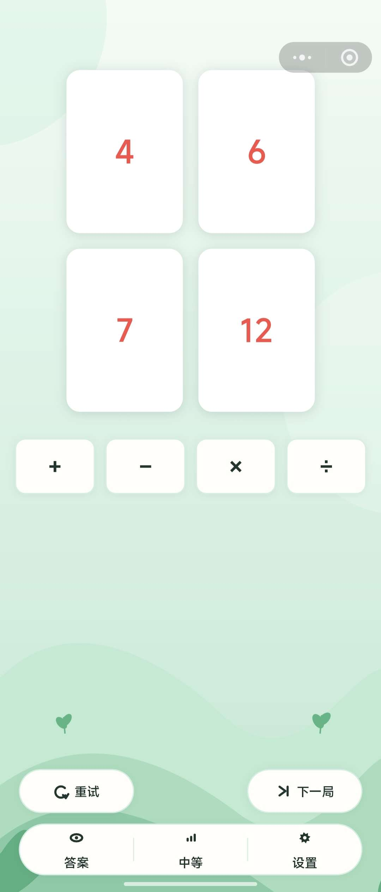

# 测试问题跟踪

未结束的问题用下面这一张表，一行一条。已结束的问题在文末「close的问题」，编号保持不变，不重新编号。先讨论再改代码。

**状态：** `open`（预览红色）/ `in progress` / `close`（预览绿色）。只给状态列上色。颜色靠工作区 `markdown.styles` 加载 [md-preview.css](md-preview.css)；预览关掉后再开一次才会生效。

**解决方案：** 讨论要点 + 末尾结论（`修改代码` / `won't fix` / `not a bug`）。格子内换行用 ` `。

日期：`YYYY-MM-DD`。未结束的结束日期留空。

表头下一行必须是分隔行（每个格子只有 `---`），再往下才是问题。

| 编号  | 问题描述                                                                                                        | 解决方案                                                                                                                    | 状态    | 创建日期       | 结束日期       |
| --- | ----------------------------------------------------------------------------------------------------------- | ----------------------------------------------------------------------------------------------------------------------- | ----- | ---------- | ---------- |
| 9   | 按中间步骤分档后 hard 太少（当前约 16 道）。                                                                                 | 先保持：必须非整数分数才算 hard；必须整除进 medium。后续从 medium 里挑选大约 30 题改标 hard（例如括号更深、要先乘再除）。结论：后续修改代码 | open | 2026-09-09 |            |
| 10  | 连胜：重开本局、查看答案、没打完回首页，会不会把连胜清零？                                                                              | 当前代码：弹出失败清零，弹出成功 +1。重开、看答案、回首页不改连胜。是否要断待确认。结论： | open | 2026-09-15 |            |
| 11  | 统计重置：只靠清缓存，还是设置页加「清零」？                                                                                      | 当前无清零按钮，清缓存会一并清掉。是否要页上入口待确认。结论： | open | 2026-09-15 |            |
| 12  | 数字 / 扑克显示。待确认：默认数字还是扑克；1 是否显示 A、11/12/13 是否显示 J/Q/K；分数/负数/0 的合成牌是否套扑克皮；花色自绘四花，每局随机还是固定顺序。 | 已从第 2 期改列入后续计划。当前只显示数字方块。产品细节未拍板。结论：后续修改代码 | open | 2026-09-15 |            |
| 15  | 卡牌和运算符的布局（大小和位置）需要针对折叠屏手机调整。原因：折叠屏手机上运算符按钮过宽，卡牌显得拥挤。 | 待讨论。 | open | 2026-09-26 |            |

### 参考图片：

#### 问题 15：折叠屏布局拥挤

## close的问题

| 编号  | 问题描述                                                                                                        | 解决方案                                                                                                                    | 状态    | 创建日期       | 结束日期       |
| --- | ----------------------------------------------------------------------------------------------------------- | ----------------------------------------------------------------------------------------------------------------------- | ----- | ---------- | ---------- |
| 1   | 分数的显示，如果结果是整数，显示整数，否则不要约分。 例子： 2 / 8，直接显示成『2/8』，这样可以知道原始点数。 例子：8 / 2，结果是整数，显示成『4』。                          | 存储不约分。显示时若分子能被分母整除则显示整数（8÷2→4），否则原样显示（2÷8→2/8）。判定 24 仍用交叉相乘。结论：修改代码 | close | 2026-09-01 | 2026-09-02 |
| 2   | 两张牌计算完成后，会合成一张牌。合成牌的位置，替换第2张点击的牌。                                                                           | 每张牌固定占 2×2 中一格。合成牌继承后点那张的格子，先点的格子留空，不按剩余张数重排。结论：修改代码 | close | 2026-09-01 | 2026-09-02 |
| 3   | 两张牌计算完成后，会合成一张牌。合成牌默认被选中作为下一轮的第1张运算牌，这样用户可以继续点击运算符，不用必须选择第1张运算牌。                                            | 合并成功后 `selectedId` 设为新牌 id，运算符清空。只剩一张并已结算时不必选中。结论：修改代码                                                                  | close | 2026-09-01 | 2026-09-09 |
| 4   | UI问题，4张牌，排列成 2 * 2的样式，方便点击。                                                                                 | 固定 2×2 格子。合并后不重排，空位留给先点的牌（见第 2 条）。结论：修改代码 | close | 2026-09-01 | 2026-09-02 |
| 5   | 每一轮运算的标准顺序是：点击第1张牌，点击运算符，点击第2张牌。可以支持这样的修改逻辑：再次点击第1张牌，这张牌被取消选中；点击选中的运算符，运算符被取消选中；点击未选中的运算符，它被选中并且取消之前选中的运算符。 | 点已选第 1 张：只取消牌，不自动清运算符。点已选运算符：取消该运算符。点其它运算符：改选它（现有逻辑已是这样）。仍须先有第 1 张才能点运算符。结论：修改代码                                        | close | 2026-09-01 | 2026-09-09 |
| 6   | 撤销的功能：不需要。                                                                                                  | 去掉对局和结算里的「撤销」按钮；`undo` 可先留在 `merge.ts` 不用。`prd.md` 同步删撤销。结论：修改代码                                                        | close | 2026-09-01 | 2026-09-09 |
| 7   | 显示答案的按钮：对局底部左下角「查看答案」，点击后显示该题答案文本。                                                    | 左下角按钮；点一下显示该题 `expression`，再点隐藏。重开 / 下一局清掉。不现场穷举。结论：修改代码 | close | 2026-09-01 | 2026-09-10 |
| 8   | 有时成功后点击下一局，卡住 5 到 10 秒。                                                                                     | 不是随机/抽题。结算弹窗叠在牌或运算符上，但底层点击区域仍在；`find` 先命中牌/运算符，成功态把这些点击丢掉，弹窗按钮收不到。弹出结算时清空 `hits`，只保留弹窗按钮。结论：修改代码 | close | 2026-09-09 | 2026-09-09 |
| 13  | 完成一次运算的动画过程中，应该允许点击运算符，开始下一轮。现在要等动画结束才能点运算符，操作被打断、不够流畅。 | 根因：`busy()` 把 merging 和发牌/结算一样整页锁死；`tap` 直接 return，运算符也不进 `hits`。合并约 540ms（飞 220 + 弹出 320）。逻辑上合并一结束 `selectedId` 已是结果牌（第 3 条），只差选运算符和第 2 张。 方案：merging 且本局未结算时开放运算符和第 2 张。点运算符立刻选中；再点第 2 张先记下，等当前飞牌/弹出结束再播下一段合并，两段动画不重叠。重试、下一局、发牌、结算弹窗仍锁定。 结论：修改代码 | close | 2026-09-26 | 2026-09-26 |
| 14  | 卡牌和运算符的位置，需要向下移动一点。原因：现在被微信小游戏右上角的系统菜单挡住了一部分。 | 对局牌面 `topY` 原写死 72，右上角胶囊菜单会压住第一行牌。改为 `max(72, capsuleBottom + 16)`，运算符跟着下移。结论：修改代码 | close | 2026-09-26 | 2026-09-26 |
| 16  | 底部的2排按钮，需要向上移动一点。原因：现在距离底部太近了，不好点击。 | 底栏原距底 18。改为 `max(34, safeBottom + 16)`（`bottomBarPad`）。对局两排和首页设置同一套边距。结论：修改代码 | close | 2026-09-26 | 2026-09-26 |
| 17  | 错误操作的提示文字（例如除以 0，没选牌就点运算符）挡住了卡牌，需要显示到运算符下方，可以和显示答案的位置一样。 | `wx.showToast` 叠在牌面上。改为对局内 hint，画在运算符下与答案同一位置（`opY + opH + 52`），约 1.8s 后消失；提示期间盖过答案。结论：修改代码 | close | 2026-09-26 | 2026-09-26 |

### 参考图片：

#### 问题 14：顶部内容被系统菜单遮挡

