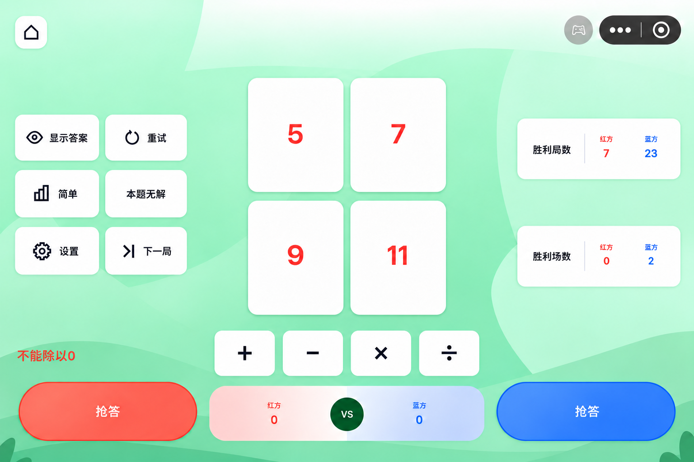

# 问题 46：宽屏双人对战布局方案

## 目标

宽屏设备上，同机双人对战的主要元素应对红、蓝双方公平：

- 卡牌和运算符位于屏幕中央，双方观察距离一致。
- 红方、蓝方抢答按钮分别靠近屏幕左右两端，方便两人同时操作。
- 比分牌位于两个抢答按钮正中间。
- 普通功能按钮和累计统计放在两侧，不干扰抢答。
- 手机竖屏布局保持不变，本方案只用于能够显示三栏的宽屏。

## 进入条件

只看宽度，不看高度。和单人不是同一条线。

- 宽度小于 748：单人、设置、双人都是手机竖排。
- 宽度达到 748：单人和设置页进入左右两栏。双人此时仍是左栏牌桌、右栏操作，不使用本方案。
- 宽度达到 928：双人进入本方案的三栏。这一档还要求居中牌桌之后，左边按钮至少宽 84，右边统计卡至少宽 140。940×665 满足。

不够 928 时，双人继续用达到 748 的那一档，不退回手机竖排。

宽屏改的是布局，并在右侧多显示胜利局数、胜利场数两张统计卡。抢答、倒计时、认输、交接、弹窗和按钮能否点击，都与手机竖屏相同。

## 设计稿



设计稿同时画出六个按钮，用来说明固定槽位。实际游戏仍根据状态显示或隐藏，隐藏后其它组件不移动。

## 页面布局

页面分为三个主要区域：

1. **左侧功能区**：六个普通功能按钮，`2 列 × 3 行`。
2. **中央牌桌区**：四张卡牌、四个运算符，整体在屏幕水平中心。
3. **右侧统计区**：胜利局数、胜利场数。

底部是双方共用的对抗区：

```text
红方抢答按钮        红方 0  VS  0 蓝方        蓝方抢答按钮
```

红、蓝抢答按钮尺寸相同、中心高度相同、到屏幕边缘的距离相同。比分牌以屏幕水平中心为基准，不跟随左右内容宽度偏移。

对抗区的显隐与手机相同：

- 等待抢答时，红、蓝抢答按钮都显示。答题中只保留正在作答的一方，按钮变成倒计时；另一方的抢答按钮藏掉，槽位留着。
- 比分牌始终在屏幕水平中心，不因为一边按钮藏起而移动。
- 「点击认输」仍出现在倒计时按钮正下方，显示 3 秒后消失。宽屏上为这一行留出高度，不盖住倒计时，也不画出屏幕。

右侧两张统计卡分别与牌面两行对齐：

- 「胜利局数」卡片的垂直中心与第一行卡牌的垂直中心一致。
- 「胜利场数」卡片的垂直中心与第二行卡牌的垂直中心一致。
- 两张统计卡的宽度和右边界一致。

## 六个功能按钮

固定槽位如下：

| | 左列 | 右列 |
| --- | --- | --- |
| 第一行 | 显示答案 | 重试 |
| 第二行 | 难度（例如「简单」） | 本题无解 |
| 第三行 | 设置 | 下一局 |

### 间距

- 单个按钮建议高度：`48–52px`，沿用现有按钮高度。
- 两列水平间距：`16px`。
- 三行垂直间距：**`24px`**，不要沿用设计稿初版中过密的距离。
- 左侧第二列按钮的右边缘，不再贴着 `+` 运算符的左边缘；两者之间至少保留 `48px`，推荐 `56–64px`。
- 右侧统计卡的左边缘，不再贴着 `÷` 运算符的右边缘；两者之间至少保留 `64px`，推荐 `72–88px`。
- 功能区整体垂直居中，不要贴近左上角的小房子。

### 状态显隐

| 状态 | 显示按钮 |
| --- | --- |
| 等待抢答 | 显示答案、难度、设置、下一局 |
| 答题中 | 重试；开启「含无解题」时显示本题无解 |
| 弹窗打开 | 只响应弹窗按钮，外层按钮不响应 |

隐藏按钮时保留其槽位，不能让其它按钮重新排列或跳动。上表和对抗区的显隐都沿用手机上的规则，宽屏只改它们所在的位置。

## 操作提示

答题过程中的临时提示，例如「不能除以0」，显示在运算符左侧：

- 文本采用左对齐；第一个字的左边缘与红方抢答按钮的外框左边缘严格使用同一个 `x` 坐标，不是与左侧功能按钮或中央牌桌对齐。
- 文本垂直中心与运算符按钮的垂直中心一致。
- 使用珊瑚红提示色，左对齐，不增加白底卡片。
- 建议字号 `13–14px`、字重 `500`。
- 提示区域只显示临时文案，不占用六个功能按钮槽位。
- 沿用现有约 `1.8s` 后自动消失的规则。

## 视觉层级

本页面的第一视觉重点是卡牌，第二视觉重点是运算符。抢答、比分和累计统计虽然重要，但不应通过过大的文字压过牌面。

建议字号层级：

| 元素 | 建议字号 | 说明 |
| --- | --- | --- |
| 卡牌数字 | 保持当前值 | 页面最大、最醒目的数字 |
| 运算符 | 保持当前值 | 不缩小 |
| 抢答按钮文字 | `14–16px` | 字重 `500–600`，按钮尺寸不变 |
| 比分数字 | `18–20px` | 作为状态信息，不与牌面数字竞争 |
| 比分「红方 / 蓝方」 | `9–10px` | 辅助标签 |
| `VS` | `10–11px` | 保持圆形标志，降低文字重量 |
| 统计标题 | `12–13px` | 例如「胜利局数」 |
| 统计队名 | `8–9px` | 红方、蓝方 |
| 统计数字 | `16–18px` | 清楚可读即可，不作为视觉焦点 |

只调整文字大小，不改变这些组件的背景、圆角、描边、阴影和整体尺寸。

## 其它组件

以下组件只调整位置，不改变当前样式：

- 卡牌的尺寸、圆角、阴影和数字字体。
- 运算符按钮的尺寸和样式。
- 红、蓝抢答按钮的颜色、描边、文字和动画。
- 比分牌的红蓝底色和中间 `VS`。
- 「显示答案」「难度」「设置」「重试」「本题无解」「下一局」的现有按钮样式。
- 背景、小房子、微信胶囊安全区域。

双人统计继续使用现有数据和样式：

- 胜利局数：红方、蓝方。
- 胜利场数：红方、蓝方。

## 代码实现方案

### 1. 宽屏使用独立布局

不要继续把宽屏双人布局塞进单人和双人共用的 `tableLayout`。卡牌尺寸计算可以复用，但双人宽屏的三栏结构、抢答区和统计区属于双人专用布局。

建议新增纯布局函数，例如：

```ts
duelWideLayout(width, height, minTop, bottomPad)
```

它只计算矩形，不绘制 UI，也不读取或修改游戏状态。返回值建议包含：

```ts
{
  table: { slots, ops, fontSize },
  utilitySlots: {
    answer, restart,
    difficulty, unsolvable,
    settings, next,
  },
  stats: { rounds, matches },
  battle: { redBuzz, score, blueBuzz },
  hint: { x, y, maxWidth },
}
```

宽度小于 928 时不使用本方案。达到 748 的双人仍走左栏牌桌，更窄的屏幕走手机竖排。

### 2. 六个按钮只定义一次位置

六个槽位统一由 `utilitySlots` 计算。场景根据当前状态决定是否绘制、是否加入 `hits`，不要在各状态下重新计算位置。

这样可以保证：

- 按钮显隐时其它按钮不移动。
- 绘制区域和点击区域使用同一个 `Rect`。
- 三行间距统一为 `24px`。
- 后续修改间距只需改布局函数。

### 3. 公平性约束

布局函数应直接保证：

- 中央牌桌中心等于屏幕水平中心。
- `redBuzz.w === blueBuzz.w`，`redBuzz.h === blueBuzz.h`。
- 两个抢答按钮的中心 `y` 相同。
- 红、蓝按钮到左右屏幕边缘的距离相同。
- 比分牌中心等于屏幕水平中心。
- 功能按钮和统计卡不与抢答按钮、牌桌重叠。
- 左侧第二列按钮与 `+` 运算符之间的水平净距不小于 `48px`。
- `÷` 运算符与右侧统计卡之间的水平净距不小于 `64px`。
- `stats.rounds` 的中心 `y` 等于第一行卡牌中心 `y`。
- `stats.matches` 的中心 `y` 等于第二行卡牌中心 `y`。
- `hint.x === redBuzz.x`，这里比较的是提示文字第一个字与按钮外框的左边缘，不附加文字内边距。
- `hint.y` 等于运算符按钮的中心 `y`。

不要根据左侧按钮文字宽度或右侧统计内容动态推动中央牌桌。

### 4. 保留现有业务规则

本次只调整宽屏布局，不修改：

- 抢答、倒计时、认输、交接和胜负流程。
- 按钮的显示规则和点击行为。
- 比分、胜利局数和胜利场数统计。
- 卡牌、运算符和动画逻辑。
- 手机竖屏布局。

## 自动化测试建议

为纯布局函数补充测试：

1. `940×665` 时进入宽屏布局。
2. 四张卡牌的整体中心与屏幕水平中心一致。
3. 红、蓝抢答按钮尺寸相同、左右边距相同、中心高度相同。
4. 比分牌中心与屏幕水平中心一致。
5. 六个功能槽位为 `2×3`，行间距为 `24px`。
6. 所有矩形都在安全区域内且互不重叠。
7. 隐藏任一按钮不会改变其它槽位坐标。
8. 手机宽度仍返回原来的手机布局，不受宽屏方案影响。
9. 胜利局数、胜利场数分别与两行卡牌中心对齐。
10. 提示文字锚点与红方抢答按钮左边、运算符中心对齐。
11. 左侧第二列按钮与 `+`、`÷` 与右侧统计卡的净距分别达到 `48px` 和 `64px`。
12. 答题中只留一边倒计时时，另一边槽位和比分牌中心都不变。

## 手工验收

- 等待抢答：显示答案、难度、设置、下一局的位置正确。
- 答题中：只显示正在作答一方的倒计时，另一边抢答按钮藏掉但槽位留着，比分牌仍在屏幕中心。重试和本题无解使用预留槽位，页面不跳动。「点击认输」在倒计时下方，3 秒后消失。
- 未开启「含无解题」：本题无解隐藏，但重试位置不变。
- 两个人同时按左右抢答按钮时不会碰手，也不容易误触其它按钮。
- 触发「不能除以0」等错误时，提示出现在运算符左侧，不遮挡卡牌或按钮。
- 提示文字第一个字与红方抢答按钮外框严格左对齐。
- 左侧功能按钮、中央运算符和右侧统计卡之间有明显留白，不形成粘连。
- 抢答、比分和统计文字不会比卡牌数字、运算符更抢眼。
- 宽屏 `940×665` 下所有内容完整显示。
- 手机竖屏效果与修改前一致。

